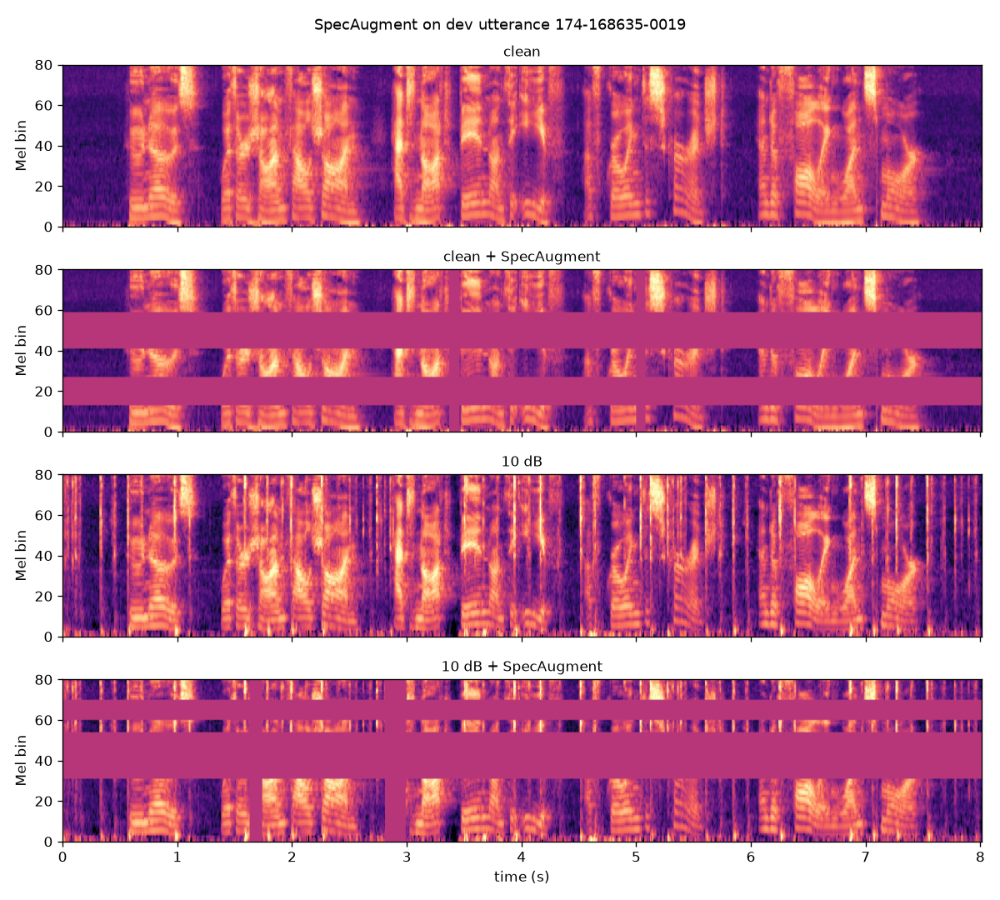

# Noise Robust End to End Speech Recognition

A character level speech recognizer built from scratch in PyTorch: a small CNN front end, a 3 layer bidirectional LSTM and CTC loss, trained on LibriSpeech. The question behind the project is simple. **How badly does a speech model break when the audio gets noisy, and how much do noise augmentation and SpecAugment fix it?**

Three models share the exact same architecture, data and training recipe. Only the augmentation changes:

| Model | Training data | Status |
|---|---|---|
| **A** | Clean LibriSpeech only (baseline) | Done |
| **B** | 80% of utterances mixed with MUSAN noise at 0 to 20 dB SNR | Done |
| **C** | Same as B, plus SpecAugment frequency and time masking | Training |

> Work in progress. Phases 1 to 14 of 20 are finished; the test set has not been touched yet. Every number below is on the **dev** set.

## Results so far

Word error rate (%) on all 2,703 dev-clean utterances, clean and with unseen MUSAN noise at fixed SNRs. Lower is better.

| Model | Clean | 20 dB | 10 dB | 5 dB | 0 dB | Mean |
|---|---|---|---|---|---|---|
| A (clean training) | 20.1 | 29.6 | 47.0 | 58.9 | 69.9 | 45.1 |
| B (noise training) | **17.8** | **19.5** | **24.4** | **30.2** | **39.6** | **26.3** |
| Relative reduction | 12% | 34% | 48% | 49% | 43% | 42% |

What stands out:

* **Noise training did not cost anything on clean speech.** It actually helped, acting as a regularizer.
* **Robustness more than doubled.** Model A loses about 50 WER points going from clean audio to 0 dB; Model B loses about 22.
* **The biggest fix is deletions.** Under heavy noise, Model A tends to output nothing for whole stretches of speech. At 0 dB its deletion rate is 14.6%; Model B brings that down to 4.2%.
* At 0 dB, Model B beats Model A on 2,433 of the 2,703 utterances.

One example at 0 dB SNR:

```
reference  OH WHY DID I ENGAGE THAT GOVERNESS
model A    OHL LIE TO THY INVOLITE TOR THE GRERFENECE
model B    O WHY DID I ENGAGE THAT GOVERNESS
```

All runs use greedy CTC decoding with no language model, so the absolute WERs are higher than what a full system would reach. The point is the comparison between models.

## How it works

```
waveform (16 kHz)
  -> [training only] mix in MUSAN noise at a random SNR      (Models B, C)
  -> 80 band log Mel spectrogram, normalized per utterance
  -> [training only] SpecAugment masks                        (Model C)
  -> CNN: 2 conv blocks, time downsampled 2x, frequency 4x
  -> BiLSTM: 3 layers, 384 units per direction
  -> linear + log softmax over 29 characters (blank, space, apostrophe, A to Z)
  -> CTC loss (training) / greedy decoding (inference)
```

* **Model size:** 10.3 M parameters.
* **Noise mixing** hits the requested SNR exactly (measured error 0.00000 dB). MUSAN noise files are split into separate train, dev and test pools, so the noise in the evaluation audio is never heard during training.
* **Evaluation conditions are fixed.** Every dev and test utterance gets one recorded noise segment that is reused at 20, 10, 5 and 0 dB, so all models are scored on byte identical audio and the curves measure the noise level, not a lucky draw.
* **Training recipe (identical for A, B and C):** 20 epochs, AdamW (lr 1e-3, weight decay 0.01), 5% warmup then cosine decay, gradient clipping at 5, mixed precision, batches of about 200 s of audio. The best epoch is picked by mean dev WER across all five conditions, the same rule for every model.
* **SpecAugment (Model C):** two frequency masks of up to 27 Mel bins and two time masks of up to 40 frames, each at most 10% of the utterance. No time warping.



## Data

| Dataset | Used for | Size |
|---|---|---|
| [LibriSpeech](https://www.openslr.org/12) train-clean-100 | training (28,539 utterances, 100.6 h, 251 speakers) | ~6 GB |
| LibriSpeech dev-clean | validation and model selection (2,703 utterances, 5.4 h) | ~0.3 GB |
| LibriSpeech test-clean | final evaluation only (2,620 utterances) | ~0.3 GB |
| [MUSAN](https://www.openslr.org/17) noise | augmentation and noisy evaluation | ~11 GB (whole corpus) |

No speaker appears in more than one LibriSpeech split. Both datasets are CC BY 4.0. Audio is **not** stored in this repo; the scripts below download and verify it. The small manifest and recipe CSVs in `data/manifests/` are included so the exact splits and noise conditions can be reproduced.

## Setup

Tested on Windows 11, Python 3.12, PyTorch 2.11 (CUDA 12.6) and an RTX 3050 6 GB laptop GPU.

```bash
python -m venv .venv
.venv\Scripts\activate            # Linux/macOS: source .venv/bin/activate

# PyTorch from the wheel index that matches your GPU driver
pip install torch==2.11.0 torchaudio==2.11.0 --index-url https://download.pytorch.org/whl/cu126
pip install -r requirements.txt   # exact versions: requirements-lock.txt

python scripts/check_env.py       # verifies the environment and the GPU
```

## Reproducing the pipeline

Every phase has a check script that prints PASS or FAIL for each test.

```bash
# data (about 18 GB download, resumable, checksums verified)
python scripts/download_data.py --datasets train-clean-100 dev-clean test-clean musan
python scripts/build_manifests.py
python scripts/build_noise_manifest.py
python scripts/make_noisy_recipes.py

# sanity checks
python scripts/check_vocab.py
python scripts/check_features.py
python scripts/check_noise.py
python scripts/check_mixing.py
python scripts/check_dataloader.py
python scripts/check_model.py
python scripts/check_ctc.py
python scripts/check_decoder.py
python scripts/overfit_test.py          # model must memorize 50 utterances
python scripts/check_specaugment.py

# training (about 5 h each on an RTX 3050)
python src/train.py --config configs/model_a.yaml
python src/train.py --config configs/model_b.yaml
python src/train.py --config configs/model_c.yaml

# quick pilot on a 5,000 utterance subset (about 1 h)
python src/train.py --config configs/model_b.yaml --limit 5000 --epochs 15 --dev-limit 500 --name stage8_b5000

# continue an interrupted run
python src/train.py --config configs/model_b.yaml --resume
```

Each run writes to `experiments/<name>/`: the resolved config, environment info, a per epoch log with dev WER and CER for every condition, step level training loss, and the dev transcripts of the best epoch. Model checkpoints (`*.pt`, 123 MB each) are kept out of git.

## Repository layout

```
configs/        base.yaml plus one small override file per model
src/            features, noise mixing, dataset, model, CTC loss, decoder,
                SpecAugment, training loop
scripts/        data download and preparation, one check script per phase
data/manifests/ utterance lists, MUSAN pools, fixed noisy recipes, vocabulary
experiments/    logs and dev predictions for every training run
results/        figures, example audio, environment report
```

## Roadmap

- [x] Environment, data download and verification
- [x] Manifests, vocabulary, log Mel features
- [x] MUSAN noise pools and exact SNR mixing
- [x] Data loading with fixed noisy evaluation conditions
- [x] CNN BiLSTM model, CTC loss, greedy decoder, overfit test
- [x] Model A: clean baseline
- [x] Model B: noise augmentation
- [ ] Model C: noise augmentation + SpecAugment
- [ ] Test set evaluation of all three models
- [ ] Plots: WER and CER vs SNR, loss curves, spectrograms
- [ ] Error analysis: substitutions, deletions, insertions
- [ ] Gradio demo: upload or record audio, add noise, see the transcript
- [ ] Paper write up

## References

* A. Graves et al., "Connectionist Temporal Classification," ICML 2006.
* V. Panayotov et al., "LibriSpeech: an ASR corpus based on public domain audio books," ICASSP 2015.
* D. Snyder, G. Chen and D. Povey, "MUSAN: A Music, Speech, and Noise Corpus," arXiv:1510.08484, 2015.
* D. S. Park et al., "SpecAugment: A Simple Data Augmentation Method for Automatic Speech Recognition," Interspeech 2019.

## Author

Sai Meghana Annepu, B.Tech CSE (AI/ML), SRM University AP. GitHub: [@Maggiee18](https://github.com/Maggiee18)
