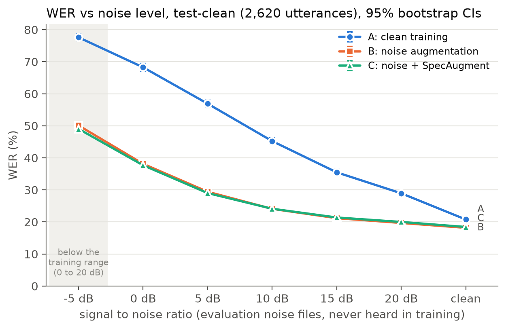
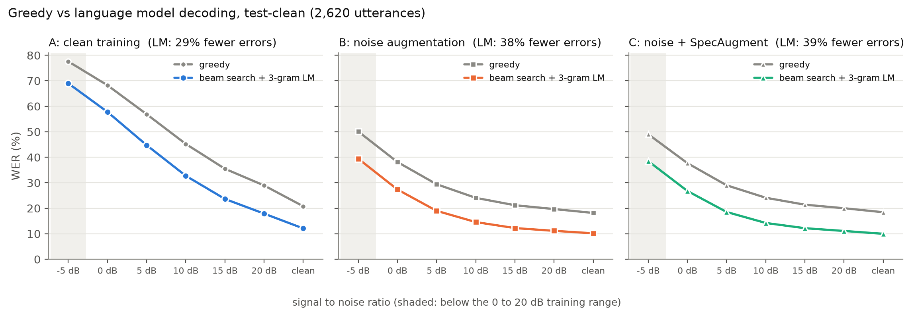

# Noise Robust End to End Speech Recognition

A character level speech recognizer built from scratch in PyTorch: a small CNN front end, a 3 layer bidirectional LSTM and CTC loss, trained on 100 hours of LibriSpeech. The question behind the project is simple. **How badly does a speech model break when the audio gets noisy, and how much do noise augmentation and SpecAugment fix it?**

Three models share the exact same architecture, data and training recipe. Only the augmentation changes:

| Model | Training data |
|---|---|
| **A** | Clean LibriSpeech only (baseline) |
| **B** | 80% of utterances mixed with MUSAN noise at 0 to 20 dB SNR |
| **C** | Same as B, plus SpecAugment (one frequency mask and one time mask) |

> **Status:** training, test evaluation, figures, error analysis, language model decoding and the demo are finished for the 20 epoch models below. A second round with 40 epochs per model is running now (the 20 epoch models had not fully converged), and the paper is being written.

## Results

Word error rate (%) on all 2,620 **test-clean** utterances, clean and mixed with MUSAN noise files that were never heard in training. Lower is better. Training used 0 to 20 dB, so −5 dB is outside what the models saw. The mean is over clean, 20, 10, 5 and 0 dB.

**Greedy CTC decoding (no language model)**

| Model | Clean | 20 dB | 15 dB | 10 dB | 5 dB | 0 dB | −5 dB | Mean |
|---|---|---|---|---|---|---|---|---|
| A (clean training) | 20.77 | 28.94 | 35.48 | 45.23 | 56.91 | 68.25 | 77.59 | 44.02 |
| B (noise training) | **18.16** | **19.68** | **21.18** | **24.08** | 29.43 | 38.14 | 50.10 | 25.90 |
| C (noise + SpecAugment) | 18.44 | 20.01 | 21.40 | 24.12 | **29.01** | **37.69** | **49.03** | **25.85** |

**Beam search with a trigram language model**

| Model | Clean | 20 dB | 15 dB | 10 dB | 5 dB | 0 dB | −5 dB | Mean |
|---|---|---|---|---|---|---|---|---|
| A (clean training) | 12.09 | 17.89 | 23.64 | 32.74 | 44.76 | 57.79 | 69.00 | 33.06 |
| B (noise training) | 10.17 | 11.14 | 12.22 | 14.58 | 18.99 | 27.36 | 39.44 | 16.45 |
| C (noise + SpecAugment) | **9.98** | **11.09** | **12.17** | **14.23** | **18.54** | **26.77** | **38.49** | **16.12** |



What stands out:

* **Noise training is the big win.** Model B cuts the mean WER by 18 points over Model A (greedy), and at 0 dB it goes from 68% to 38%. It also helps on clean speech, so it costs nothing.
* **SpecAugment adds a smaller but real gain under heavy noise.** With greedy decoding, C beats B at 5, 0 and −5 dB but is slightly worse on clean and 20 dB, so the means tie. With the language model, C beats B in every condition, and the gain is statistically significant at 10, 5, 0 and −5 dB and on the mean (−0.33 points, 95% CI [−0.51, −0.12]).
* **The language model removes about a third of the errors** for B and C (37% relative on the mean) and a quarter for A. Its gain shrinks as the noise gets worse, because it needs reasonable acoustic evidence to work with.
* **Clean trained models go silent under noise.** At −5 dB Model A deletes 23% of all words, more than half of them in runs of six or more words. Noise training almost removes those long gaps.

Every difference above comes with a paired bootstrap test (1,000 resamples over utterances). The full tables with confidence intervals are in `results/eval/test/` and `results/eval/test_lm/`.

One example at 0 dB SNR (greedy decoding):

```
reference  A LITTLE ATTACK OF NERVES POSSIBLY
model A    ALL RITLE A TANC OF NURSE MOSSO LAKE
model B    A LITTLE ATTACK OF NERVES POSSIBLY
model C    A LITTLE ATTARK OF NERVES POSSIBLY
```



### Training longer (in progress)

All three 20 epoch models reached their best dev WER on the last epoch, so each one is being retrained for 40 epochs with the same recipe. Dev results so far (mean WER over the five conditions):

| Model | 20 epochs | 40 epochs |
|---|---|---|
| A | 45.10 | running |
| B | 26.27 | 23.05 |
| C | 26.45 | **22.53** |

Both B and C converged by about epoch 38. With the longer budget, C beats B on dev in every condition, including clean. At 20 epochs, SpecAugment had not had time to pay off yet. Test results for the 40 epoch models will be added once Model A finishes.

## How it works

```
waveform (16 kHz)
  -> [training only] mix in MUSAN noise at a random SNR      (Models B, C)
  -> 80 band log Mel spectrogram, normalized per utterance
  -> [training only] SpecAugment masks                        (Model C)
  -> CNN: 2 conv blocks, time downsampled 2x, frequency 4x
  -> BiLSTM: 3 layers, 384 units per direction
  -> linear + log softmax over 29 characters (blank, space, apostrophe, A to Z)
  -> CTC loss (training)
  -> greedy decoding, or lexicon beam search with a trigram LM (inference)
```

* **Model size:** 10.3 M parameters.
* **Noise mixing** hits the requested SNR exactly. MUSAN noise files are split into separate train, dev and test pools (615 / 88 / 176 files), so the noise in the evaluation audio is never heard during training.
* **Evaluation conditions are fixed.** Every dev and test utterance gets one recorded noise segment that is reused at every SNR, so all models are scored on identical audio and the curves measure the noise level, not a lucky draw.
* **Training recipe (identical for A, B and C):** 20 epochs (40 in the second round), AdamW (lr 1e-3, weight decay 0.01), 5% warmup then cosine decay, gradient clipping at 5, mixed precision, batches of about 200 s of audio. The best epoch is picked by mean dev WER across all five dev conditions, the same rule for every model.
* **SpecAugment (Model C):** one frequency mask of up to 27 Mel bins and one time mask of up to 40 frames (at most 10% of the utterance). No time warping. The stronger policy with two masks of each kind slowed learning too much in a pilot run (59.0% vs 54.0% dev WER), so the milder one was used.
* **Language model decoding:** the official LibriSpeech pruned trigram (OpenSLR 11, trained on book text with the dev and test books excluded) and its 200,000 word lexicon, through torchaudio's CTC beam search decoder (beam 50). The LM weight and word score were tuned on dev only; the test set was decoded once. On Windows the KenLM library is not available, so `src/ngram_lm.py` implements the same ARPA backoff scoring in Python (checked against KenLM: identical transcripts).
* **No peeking at the test set.** All choices were made on dev, and each model and decoding method was run on test exactly once (logged in `results/eval/test_runs.log`).


## Demo

A Gradio app lets you upload or record audio, mix in noise at any SNR from −5 to 20 dB, and compare the three models side by side, with every word error marked.

```bash
pip install gradio
python demo/app.py                 # opens http://127.0.0.1:7860
python demo/app.py --device cpu    # keep the GPU free
python demo/check_demo.py          # checks the demo matches the evaluation exactly
```

The demo needs the trained checkpoints in `experiments/<model>/best.pt`. They are 123 MB each, so they are not in git; they will be attached to a GitHub Release.

## Data

| Dataset | Used for | Size |
|---|---|---|
| [LibriSpeech](https://www.openslr.org/12) train-clean-100 | training (28,539 utterances, 100.6 h, 251 speakers) | ~6 GB |
| LibriSpeech dev-clean | validation and model selection (2,703 utterances, 5.4 h) | ~0.3 GB |
| LibriSpeech test-clean | final evaluation only (2,620 utterances) | ~0.3 GB |
| [MUSAN](https://www.openslr.org/17) noise | augmentation and noisy evaluation | ~11 GB (whole corpus) |
| [LibriSpeech LM](https://www.openslr.org/11) 3-gram.pruned.1e-7 | language model decoding | ~34 MB |

No speaker appears in more than one LibriSpeech split. The datasets are CC BY 4.0 (the LM is public domain). Audio is **not** stored in this repo; the scripts below download and verify it. The small manifest and recipe CSVs in `data/manifests/` are included so the exact splits and noise conditions can be reproduced.

## Setup

Tested on Windows 11, Python 3.12, PyTorch 2.11 (CUDA 12.6) and an RTX 3050 6 GB laptop GPU.

```bash
python -m venv .venv
.venv\Scripts\activate            # Linux/macOS: source .venv/bin/activate

# PyTorch from the wheel index that matches your GPU driver
pip install torch==2.11.0 torchaudio==2.11.0 --index-url https://download.pytorch.org/whl/cu126
pip install -r requirements.txt   # exact versions: requirements-lock.txt
pip install flashlight-text       # only for language model decoding

python scripts/check_env.py       # verifies the environment and the GPU
```

## Reproducing the pipeline

Every phase has a check script that prints PASS or FAIL for each test.

```bash
# data (about 18 GB download, resumable, checksums verified)
python scripts/download_data.py --datasets train-clean-100 dev-clean test-clean musan
python scripts/build_manifests.py
python scripts/build_noise_manifest.py
python scripts/make_noisy_recipes.py

# sanity checks
python scripts/check_vocab.py
python scripts/check_features.py
python scripts/check_noise.py
python scripts/check_mixing.py
python scripts/check_dataloader.py
python scripts/check_model.py
python scripts/check_ctc.py
python scripts/check_decoder.py
python scripts/overfit_test.py          # model must memorize 50 utterances
python scripts/check_specaugment.py

# training (about 5 h each on an RTX 3050 for 20 epochs)
python src/train.py --config configs/model_a.yaml
python src/train.py --config configs/model_b.yaml
python src/train.py --config configs/model_c_lb.yaml
# 40 epoch versions: configs/model_a_e40.yaml, model_b_e40.yaml, model_c_lb_e40.yaml
# continue an interrupted run: add --resume

# evaluation with greedy decoding (dev first, test once)
python scripts/evaluate.py --split dev --models model_a_clean model_b_noise model_c_lb
python scripts/evaluate.py --split test --models model_a_clean model_b_noise model_c_lb --extra-snrs -5 15

# language model decoding: download the LM, tune on dev, then decode dev and test
python scripts/prepare_lm.py
python scripts/decode_lm.py --split dev --models model_a_clean model_b_noise model_c_lb --tune
python scripts/decode_lm.py --split dev --models model_a_clean model_b_noise model_c_lb
python scripts/decode_lm.py --split test --models model_a_clean model_b_noise model_c_lb --extra-snrs -5 15

# figures, tables and error analysis (add --split dev, and/or --decoding lm)
python scripts/make_plots.py
python scripts/error_analysis.py
```

Each training run writes to `experiments/<name>/`: the resolved config, environment info, a per epoch log with dev WER and CER for every condition, step level training loss, and the dev transcripts of the best epoch.

## Repository layout

```
configs/          base.yaml plus one small override file per model
src/              features, noise mixing, dataset, model, CTC loss, decoder,
                  SpecAugment, training loop, inference, Python n-gram LM
scripts/          data preparation, check scripts, evaluation, LM decoding,
                  plots, error analysis
demo/             Gradio demo and its consistency check
data/manifests/   utterance lists, MUSAN pools, fixed noisy recipes, vocabulary
experiments/      logs and dev predictions for every training run
results/eval/     WER / CER per condition, predictions, significance tables
results/plots/    figures (test, dev, and *_lm for language model decoding)
results/analysis/ error analysis reports, example transcripts, figures
results/lm/       language model tuning results and chosen parameters
```

## Roadmap

- [x] Environment, data download and verification
- [x] Manifests, vocabulary, log Mel features
- [x] MUSAN noise pools and exact SNR mixing
- [x] Data loading with fixed noisy evaluation conditions
- [x] CNN BiLSTM model, CTC loss, greedy decoder, overfit test
- [x] Model A: clean baseline
- [x] Model B: noise augmentation
- [x] Model C: noise augmentation + SpecAugment
- [x] Test set evaluation of all three models, with bootstrap significance tests
- [x] Plots: WER and CER vs SNR, error types, training curves
- [x] Error analysis: substitutions, deletions, insertions, rare words
- [x] Gradio demo: upload or record audio, add noise, compare the models
- [x] Beam search decoding with a trigram language model
- [ ] 40 epoch versions of all three models (B and C done, A running)
- [ ] Checkpoints as a GitHub Release
- [ ] Paper write up

## References

* A. Graves et al., "Connectionist Temporal Classification," ICML 2006.
* V. Panayotov et al., "LibriSpeech: an ASR corpus based on public domain audio books," ICASSP 2015.
* D. Snyder, G. Chen and D. Povey, "MUSAN: A Music, Speech, and Noise Corpus," arXiv:1510.08484, 2015.
* D. S. Park et al., "SpecAugment: A Simple Data Augmentation Method for Automatic Speech Recognition," Interspeech 2019.
* V. Pratap et al., "Wav2Letter++: The Fastest Open source Speech Recognition System," ICASSP 2019 (the flashlight decoder).
* K. Heafield, "KenLM: Faster and Smaller Language Model Queries," WMT 2011.
* B. Efron and R. Tibshirani, *An Introduction to the Bootstrap*, 1993.

## Author

Sai Meghana Annepu, B.Tech CSE (AI/ML), SRM University AP. GitHub: [@Maggiee18](https://github.com/Maggiee18)
